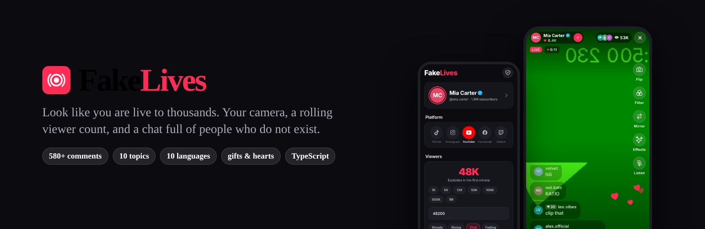
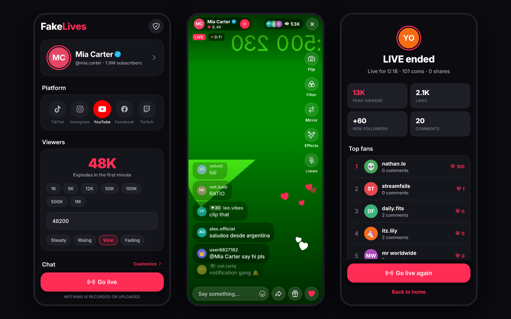

<p align="center">
  
</p>

<p align="center">
  
  
  
  
</p>

# FakeLives

FakeLives makes it look like you are streaming live to thousands of people. Pick a platform look (TikTok, Instagram, YouTube, Facebook or Twitch), a name, a viewer count and how the chat should behave, hit **Go live**, and your camera fills the screen under a verified badge, a rolling viewer counter and a chat full of people who do not exist. Turn on **Viewers hear you** and the chat answers what you actually say.

It is the successor to [fakeLive](https://github.com/zqh7y/fakeLive), rebuilt from scratch in TypeScript with a real simulation engine behind the chat, far more personalization, and a dark, single-accent UI with proper animations.

## What's new compared to the old app

| | fakeLive (2024) | FakeLives |
|---|---|---|
| Comments | 30 lines, 20 usernames | 580+ lines in 10 topic packs and 10 languages, 200+ curated handles plus a generator |
| Chat behaviour | 3 random comments every 1.5 s | Engine with speed levels, bursts, copycat waves, newcomers who say hi, reactions to what you type, viewer milestones |
| Platforms | one TikTok-ish look | five looks: TikTok, Instagram, YouTube, Facebook, Twitch, each with its own top bar, chat style, colours and money |
| Events | none | joins, follows, shares, gifts (roses to lions), donations (Super Chats in tier colours, Stars, Bits, badges, gift subs) with toasts and banners |
| Voice | none | optional speech recognition: the chat replies to what you say and stays on your topic (offline keyword engine) |
| Viewers | ±10 % random walk | growth modes: steady, rising, viral, fading, with surges and dips |
| Personalization | name, picture, count | name, username, bio, verified toggle, auto or manual stats, viewer presets or any number, topic packs, languages, event toggles, mentions, your own comments, camera filters, mirroring |
| After the live | nothing | summary screen with peak and average viewers, likes, new followers, comments, coins and top fans |
| UI | light, static | dark, one accent, odometer counters, floating hearts, slide-in chat, press feedback, haptics |
| Code | JavaScript, one file per screen | TypeScript strict, Expo Router, Zustand store, reusable components, type-checked and linted |

## Screens

<p align="center">
  
</p>

- **Home**: profile card, platform look, viewer count with presets or a custom number, growth mode, chat speed, Go live.
- **Profile**: photo, display name, username, bio, verified badge, automatic or manual followers/likes/following.
- **Chat**: speed, 10 topic packs, 10 languages, event toggles, mentions, voice, up to 50 comments of your own.
- **Live**: camera, the platform's top bar and chat style, rolling viewer counter, LIVE tag, timer, badges, gifts and donations, floating hearts (reactions on Facebook, none on Twitch), toasts, banners for big money, filters, flip, mirror, a mic button, profile sheet, and your own comments that the chat reacts to.
- **Summary**: how the live went, with top fans.
- **Privacy**: what the app does and does not do.

## How it works

```
src/
  app/            Expo Router screens: index, profile, chat-settings, live, summary, privacy
  components/     shared UI (Button, Card, Chip, Slider, Avatar, NumberTicker, ...) and live/ overlays
  components/live/platforms/   tiktok, instagram, youtube, facebook, twitch: TopBar, ChatItem, BottomBar
  constants/      theme.ts (the one place for colours, spacing, type), platforms.ts, options.ts
  data/           comments.ts (packs, languages, mentions, donations), usernames.ts, gifts.ts, avatars.ts
  engine/         live-engine.ts (the simulation), bots.ts (the crowd), topic-engine.ts (what you said)
  hooks/          use-live-session.ts, use-speech-listener.ts, use-theme.ts
  store/          settings-store.ts (Zustand + AsyncStorage)
  utils/          format, random, haptics
```

The live engine is plain TypeScript. It runs timers for viewers, comments, likes, joins, follows, shares and gifts, and reports through a listener. The crowd is a weighted pool: regulars post more, newcomers drift in and sometimes say hi, and short hype gets echoed by others. When you type a comment, a few bots react to it. When the viewer count crosses a milestone, the chat notices.

**Voice.** With "Viewers hear you" on, the Live screen listens through the microphone using the phone's own speech recognizer (`expo-speech-recognition`). Each sentence goes through `topic-engine.ts`, which picks out keywords, guesses the topic (gaming, music, food, fitness, beauty, love, hype), spots intents (greetings, goodbyes, "follow me", "send a gift", questions, numbers, birthdays, being tired or hungry) and writes a few replies: echoes of your words, answers to questions, comments from the matching topic pack. The chat then stays on that topic for the next 45 seconds. It is keyword matching, not a language model, and it is all offline. Speech recognition itself is done by iOS or Android and needs a development build; it is not available in Expo Go.

Everything else is simulated on the device. There is no network code of its own, no account and no analytics. The camera is only a preview.

## Run it

```bash
git clone https://github.com/zqh7y/FakeLives.git
cd FakeLives
npm install
npx expo start
```

Scan the QR code with Expo Go, or press `a` for Android or `i` for iOS. The camera only shows a picture on a real device; elsewhere a moving placeholder is shown so everything else still works. Everything works in Expo Go except voice, which needs a development build because speech recognition is a native module:

```bash
npx expo run:android
```

```bash
npm run typecheck   # tsc --noEmit
npm run lint        # expo lint
```

## Build

```bash
npx eas build -p android --profile preview
```

## Tech

Expo SDK 58, React Native 0.88, Expo Router, TypeScript (strict), React Native Reanimated 4, Zustand, expo-camera, expo-image-picker, expo-haptics, expo-keep-awake, expo-speech-recognition, Inter via `@expo-google-fonts/inter`.

The platform looks are imitations for entertainment and are not affiliated with or endorsed by TikTok, Instagram, YouTube, Facebook or Twitch.

---

<p align="center">
  Made by <b>zzqxck</b> · <a href="https://zqh7y.github.io/Portfolio/">portfolio</a> · <a href="https://github.com/zqh7y">more projects</a>
</p>
